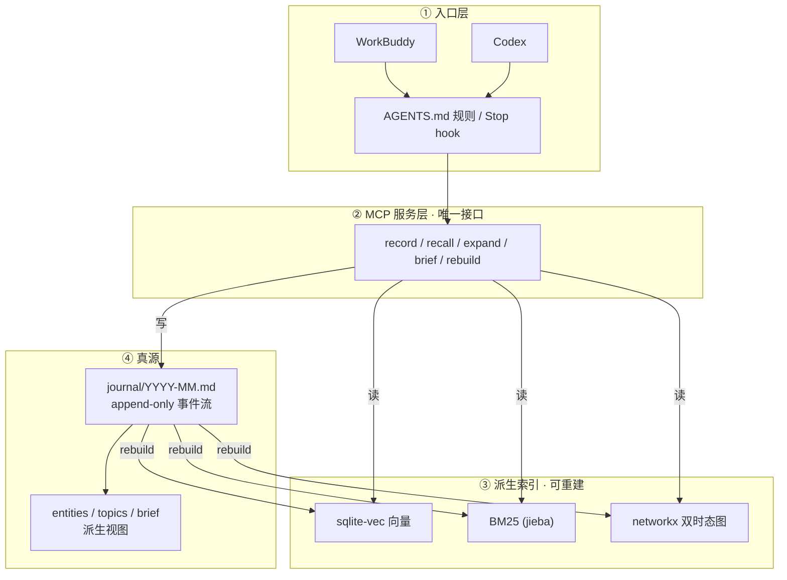

# 连溯 Liansu

> 本地长期记忆系统：以 Markdown vault 为唯一真源、以 MCP 为唯一接口、全自动抽取的个人记忆层。

让任意 Agent 平台（WorkBuddy / Codex）跨会话记住你的事实、偏好与决策 —— 通过本地 MCP server，不依赖 Obsidian 客户端，无独立 UI。

## 状态

17 个开发任务全部落地，**135 个单测 + 25 项端到端断言全部通过**，5 个 MCP 工具可用，`record → recall → expand` 全链路在真实 LLM 上跑通。

## 核心设计

| 原则 | 实现 |
|---|---|
| 真源唯一 | `journal/` append-only Markdown 是唯一权威，索引与视图全部可 rebuild |
| 协议收敛 | 所有能力经 MCP 暴露：`record` / `recall` / `expand` / `brief` / `rebuild` |
| 全自动写入 | 宿主 Stop hook → LLM gate → 抽取 → confidence 门控 → supersede → append |
| 按需检索 | 规则引导 agent 主动调 `recall`，不每 session 强注入 |
| 时效内建 | 每条 fact 带 `valid_from`/`valid_to`，能回答「现在是否成立」 |
| 模型解耦 | provider 层统一；默认走 Windows 主机 OpenAI-compatible /v1，config 一处切换 |

## 架构



## 快速开始

```bash
# 依赖（Python >= 3.11）
python -m venv .venv && .venv/bin/pip install -e .

# 离线演示完整链路（record → recall → expand → 时效）
.venv/bin/python demo.py

# 用真实 Windows LLM 服务跑（先 curl /health 确认 IP）
.venv/bin/python demo.py --real
```

## 接入 WorkBuddy / Codex

详见 [`docs/integration.md`](docs/integration.md)。核心步骤：

1. **WorkBuddy**：在 `~/.workbuddy/mcp.json` 注册本地 server（stdio），连接器页点「信任」，工具列表出现 5 个工具。
2. **Codex**：在 `~/.codex/hooks.json` 的 Stop 数组挂 `liansu capture --stdin`，会话结束自动落盘。
3. **规则**：`AGENTS.md` 里写明「涉及用户画像/历史决策时先调 recall」，作为按需检索的触发开关。

## 5 个工具

| 工具 | 何时用 | 参数 |
|---|---|---|
| `record` | 用户透露个人信息/偏好/决策，或会话结束 | `dialog`（JSON 或文本）、`source` |
| `recall` | 涉及用户画像、历史决策、偏好、过往项目 | `query`、`top_k`、`stage`(0-3) |
| `expand` | 顺着一条事实做多跳关联推理 | `fact_id`、`hops`(≤3) |
| `brief` | 仅长任务开局要全局画像 | `max_tokens` |
| `rebuild` | 索引/视图损坏、换 embedding 模型 | `verify` |

## 命令行

```bash
.venv/bin/liansu capture --stdin          # Stop hook 入口
.venv/bin/liansu record '{"role":"user","content":"..."}' --source cli
.venv/bin/liansu recall "求职目标城市" --top-k 5 --stage 3
.venv/bin/liansu expand F-20261122-001 --hops 1
.venv/bin/liansu brief --max-tokens 500
.venv/bin/liansu rebuild --verify
```

## 目录

```
src/liansu/
├── schema.py          Fact 模型（三元组 + statement + 双时态）
├── config.py          config 加载 + 环境变量覆盖
├── providers/         LLM provider（OpenAI 兼容 / Ollama）+ Embedder + bge
├── vault/             journal 真源 + views 派生视图
├── capture/           zstd/jsonl 会话解析 + Stop hook
├── extract/           gate / extractor / pipeline 写路径
├── index/             bm25 / vector / graph / fuse / expand 读路径
├── mcp_server.py      5 个 MCP 工具
├── rebuild.py         全量重建
└── cli.py             命令行入口
eval/                  评测指标 + 消融 runner
evalset/               自建 gold.jsonl（24 题，含时效样本）
```

## 评测

```bash
.venv/bin/python -m pytest tests/ -q        # 135 个单测（全 mock，约 1s）
.venv/bin/python scripts/e2e_real.py        # 端到端真实链路（真实 LLM + bge，约 30s）
.venv/bin/python -m eval.runner --gold evalset/own/gold.jsonl --stages 0 1 2 3
```

分阶段消融：Stage0 仅 BM25 → +向量 → +图 → +时效，逐级记录 HitRate/Recall/MRR/时效正确率。数字待真实 vault + bge 模型到位后填入 `docs/EVAL_REPORT.md`。

端到端测试走 `build_context()` 生产装配，从 MCP 协议层进入，覆盖 record → 真源 → 三路索引 → 消融检索 → expand → 视图 → rebuild → 幂等 → stdio 子进程共 25 项断言。首轮跑通即发现并修复 5 个 mock 测不出的缺陷（fact id 跨批重复、模型编造日期、`"null"` 字符串、SQLite 跨线程、source 被覆盖），详见 `docs/E2E_REPORT.md`。

## 已知限制

- **向量检索**首次需下载 `BAAI/bge-small-zh-v1.5`（约 100MB）；未就绪时融合层自动降级为 BM25，不报错。
- **T7 用 networkx 自建双时态图**替代 Graphiti（后者依赖 neo4j）；接口保持 `Index` 契约，后续可替换。
- **Codex Stop hook 拿不到对话文本**，落盘依赖读最新会话文件兜底（见 `docs/hook-probe.md`）。
- Windows LLM 服务 **IP 会变**，接入前先 `curl /health`。

## 文档

- [技术方案](docs/TECH_DESIGN.md)
- [任务拆分](docs/TASKS.md)
- [接入指南](docs/integration.md)
- [hook 实验](docs/hook-probe.md)
- [评测集说明](docs/evalset.md)
- [面试讲稿](docs/INTERVIEW.md)

## License

MIT
