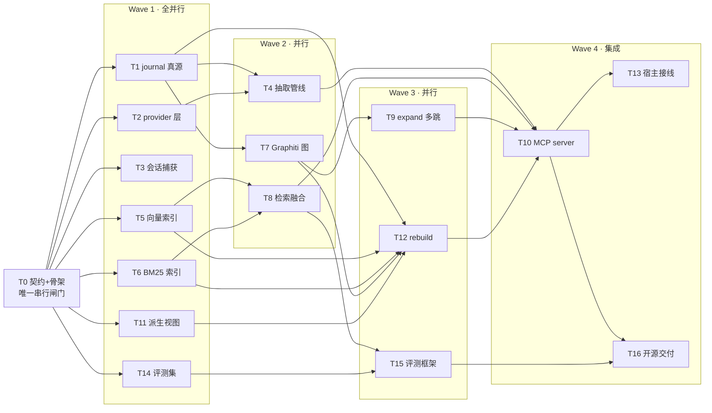

# 连溯（Liansu）— 可执行开发任务拆分

> 版本 v1.0 · 2026-11-22 · 依据 `TECH_DESIGN.md` v1.0
> 目标：17 个 task / 5 个波次，除 T0 外全部可并行；每个 task 有明确输入、输出、命令与验收标准（DoD）。

---

## 0. 并行开发的三条铁律

1. **契约先行**：T0 冻结 schema / provider ABC / index ABC 后，其余 task 只对接口编程，不互相等实现。
2. **mock 解耦**：并行期用 `tests/fixtures/` 里的 mock provider / mock index / 固定对话样例；真实实现到位后替换，不改上层代码。
3. **独立可测**：每个 task 自带 pytest，不依赖他人代码能跑通才算完成；集成只在 T10 / T13 做。

分支策略：T0 合入 main 后，每个 task 从 main 拉独立 branch（或 git worktree），完成后 PR 合入。

---

## 1. 目标目录结构

```
liansu/
├── pyproject.toml
├── config.yaml
├── src/liansu/
│   ├── __init__.py
│   ├── config.py              # T0
│   ├── schema.py              # T0  Fact 模型 + YAML 序列化
│   ├── providers/
│   │   ├── base.py            # T0  LLMProvider / Embedder ABC
│   │   ├── api.py             # T2  OpenAI-compatible（默认，指向 Windows 主机）
│   │   └── ollama.py          # T2  可选，离线兜底
│   ├── vault/
│   │   ├── journal.py         # T1  真源 append + 失效事件 + 事件流重放
│   │   └── views.py           # T11 entities/topics/brief 派生视图
│   ├── capture/
│   │   ├── parse.py           # T3  zstd/jsonl 会话解析
│   │   └── hook.py            # T3  Stop hook 入口
│   ├── extract/
│   │   ├── gate.py            # T4  值得记判断
│   │   ├── extractor.py       # T4  结构化抽取 + confidence
│   │   └── pipeline.py        # T4  编排
│   ├── index/
│   │   ├── base.py            # T0  Index ABC
│   │   ├── bm25.py            # T6
│   │   ├── vector.py          # T5
│   │   ├── graph.py           # T7  Graphiti
│   │   └── fuse.py            # T8  RRF + 时效过滤
│   ├── mcp_server.py          # T10 FastMCP 五个工具
│   ├── rebuild.py             # T12
│   └── cli.py                 # T3/T16 命令行入口
├── tests/fixtures/            # T0 建，各 task 复用
├── eval/datasets/                   # T14
│   ├── public/
│   └── own/gold.jsonl
├── docs/
└── .liansu/                   # 运行时产物（gitignore）
    └── index.db
```

---

## 2. 依赖关系图



---

## 3. 并行波次总览

| 波次 | 可并行 task | 关键路径 | 建议周期 |
|---|---|---|---|
| W0 闸门 | T0 | T0 | W1 |
| W1 基础并行 | T1, T2, T3, T5, T6, T11, T14（7 个） | T1 / T2 | W1-3 |
| W2 主线并行 | T4, T7, T8（3 条线） | T4 / T8 | W3-5 |
| W3 增强并行 | T9, T12, T15（3 个） | T15 | W5-7 |
| W4 集成交付 | T10 → T13 → T16 | T10 | W7-10 |

**最长依赖链**：`T0 → T1 → T4 → T10 → T13 → T16`（写路径）与 `T0 → T5/T6 → T8 → T15 → T16`（读路径），两条链并行推进。

> 注：T7（Graphiti）技术上在 W1 即可启动，但按方案「先 embedding 建边、后上图」的教训，排到 W2 是为了先拿到无图基线，能量化图的边际增益。

---

## 4. 任务卡

### T0 · 契约冻结与工程骨架
- **前置**：无 ｜ **波次**：W0 ｜ **阻塞**：全部
- **产出**：`pyproject.toml`、`config.yaml`、`schema.py`、`providers/base.py`、`index/base.py`、`config.py`、`tests/fixtures/*`
- **步骤**
  1. `pyproject.toml` 依赖：`fastmcp pydantic pyyaml rank-bm25 jieba sqlite-vec sentence-transformers ollama zstandard pytest`
  2. `schema.py`：Fact 模型字段严格对齐 TECH_DESIGN §3（`id/subject/predicate/object/statement/valid_from/valid_to/confidence/topics/source/created_at/supersedes`），实现 `to_yaml() / from_yaml()`
  3. `providers/base.py`：`LLMProvider` ABC（`gate(dialog)->bool`、`extract(dialog)->list[Fact]`、`judge(...)`）与 `Embedder` ABC（`embed(text)->list[float]`）
  4. `index/base.py`：`Index` ABC（`add / search / rebuild / close`）
  5. `config.yaml`（Windows 实测参数，来源见 TECH_DESIGN §5.2.1）：
     ```yaml
     llm:
       default: openai_compatible
       base_url: http://192.168.0.100:8080/v1   # IP 会变，接入前 curl /health 确认
       api_key: dummy                            # 本地服务不校验
       model: local                              # 服务端忽略 model 匹配，惯例填 local
       extra_body:
         chat_template_kwargs:
           enable_thinking: false                # Qwen3 必加，否则 JSON 外混入思考文本
     confidence_threshold: 0.7
     top_k: 5
     ```
     **base_url / api_key / model 支持环境变量覆盖，不硬编码进代码**；IP 变更只改 config 一处。
  6. `tests/fixtures/`：一段真实对话样例 `dialog.json`、一条合法 fact `fact.yaml`、mock provider / mock index
- **DoD**：`pytest` 通过；Fact YAML round-trip 一致；`python -c "import liansu"` 成功；所有后续 task 只 import 这三个契约文件

### T1 · journal 真源读写（写路径核心）
- **前置**：T0 ｜ **波次**：W1 ｜ **可并行**：是
- **产出**：`vault/journal.py`、`tests/test_journal.py`
- **步骤**
  1. `append(fact)`：按 `journal/YYYY-MM.md` 分片追加，`fcntl.flock` 文件锁保证并发安全
  2. **事件流设计（重要）**：journal 追加两类事件——`fact` 与 `supersede`（记录 `old_id + 时间`）。**不原地改旧行的 `valid_to`**，而是在重放时计算有效状态。理由：TECH_DESIGN §3 写「给旧行打 valid_to」，那会破坏 append-only 铁律；改为追加失效事件后，真源纯 append、时效仍可表达
  3. `iter_facts(valid_only=True)`：重放事件流，返回当前有效 fact，被 supersede 的自动带 `valid_to`
  4. `get_by_id(fact_id)`、`find_by_key(subject, predicate)`（供去重）
  5. `replay()`：从空状态重放全部事件，结果供 rebuild 校验
- **DoD**：并发 append 100 条不丢不重；supersede 后 `iter_facts` 不再返回旧 fact 且其 `valid_to` 正确；任意中间状态可 `git diff` 审计
- **风险**：与 TECH_DESIGN §3 措辞有差异，落地后需同步更新方案文档

### T2 · LLM provider 层
- **前置**：T0 ｜ **波次**：W1 ｜ **可并行**：是
- **产出**：`providers/api.py`（默认）、`providers/ollama.py`（可选兜底）、`tests/test_providers.py`
- **步骤**
  1. `ApiProvider`（**默认**）：用 `openai` SDK 指向 `http://192.168.0.100:8080/v1`；`base_url` / `api_key: dummy` / `model: local` 全部从 config + 环境变量读，不写死。实测四端点可用：`/v1/chat/completions` 200、`/v1/models` 200、`/health` 200，`/api/chat` 与 `/api/generate` **404**（非 Ollama 协议，禁止用 Ollama client 直接指）
  2. `OllamaProvider`（可选）：仅指本机自己起的 Ollama（localhost:11434）作离线兜底；**注意 Windows 8080 不是 Ollama 端点**，两者不可混用
  3. JSON Schema 约束输出：`chat.completions` 传 `response_format={"type":"json_schema", ...}`（llama.cpp 原生支持，实测可用）；**必须同时传 `extra_body={"chat_template_kwargs": {"enable_thinking": false}}`** 关闭 Qwen3 thinking，否则 JSON 外混入思考文本导致解析失败；解析失败重试一次
  4. `gate()`：规则前置（纯代码改动、闲聊关键词直接 False）+ LLM 二段判断，输出 bool
  5. `extract()`：按 Fact schema 输出 `facts[]`；`judge()`：G-Eval / LLM-as-Judge 打分，供 T15 复用
  6. 连接健壮性：超时、重试、主机不可达时明确报错（不静默降级到另一个 provider）
  7. **8001 业务层仅作对照，不作入口**：`POST http://192.168.0.100:8001/extract` 返回 `{memories:[{type, content, importance}]}`，缺 subject/predicate/双时态，不满足连溯 schema（理由见 TECH_DESIGN §5.2.1），不做数据依赖
- **DoD**：mock provider 单测覆盖 gate 真假两路、抽取 schema 校验、解析失败重试；真实 Windows 端点用 `model:"local"` + 关 thinking 跑通一次结构化输出；切换 config 不改任何调用方代码
- **环境状态**：已实测连通（2026-11-22）——8080/8001 `/health` 均 200、`/v1/models` 200、`model:"local"` 调用成功。**唯一运维风险：Windows IP 曾从 .103 变 .100，接入前先 `curl /health` 确认**

### T3 · 会话捕获与解析
- **前置**：T0 ｜ **波次**：W1 ｜ **可并行**：是 ｜ **最高优先级实验**
- **产出**：`capture/parse.py`、`capture/hook.py`、`cli.py`、`docs/hook-probe.md`
- **步骤**
  1. **先做实验**：写一个脚本把 Codex Stop hook 的 stdin 原样 dump 到文件，跑一轮真实会话，记录字段结构 → `docs/hook-probe.md`。这是全系统最脆弱点，结论决定写路径能否全自动
  2. `parse.py`：解析 `~/.codex/archived_sessions/rollout-*.jsonl.zst`（`zstd -d` 或 `zstandard` 库），提取 user/assistant 文本；同时兼容 `sessions/` 下的活跃文件
  3. `hook.py`：入口 `liansu capture --stdin`，拿不到文本时降级读归档文件；失败写明确错误日志
  4. 会话边界：hook 触发为准，短空闲兜底
- **DoD**：对一个真实归档文件解析出 ≥1 轮完整对话；hook 实验报告落盘并给出「能否拿到当前会话」的明确结论；降级路径有单测
- **风险**：实测 `~/.codex/sessions/` 为空、归档才有内容——若 Stop 触发时当前会话未落盘，必须靠 stdin 文本兜底

### T4 · 抽取管线编排（写路径）
- **前置**：T0 + T1/T2（并行期用 mock）｜ **波次**：W2 ｜ **可并行**：是
- **产出**：`extract/gate.py`、`extractor.py`、`pipeline.py`、`tests/test_pipeline.py`
- **步骤**
  1. `pipeline.record(dialog)`：`gate(dialog)` → 否即返回空；是则 `extract(dialog)`
  2. confidence gate：`confidence < 0.7` 丢弃（阈值走 config）
  3. 去重：对每条 fact 调 `find_by_key(subject, predicate)`；命中则生成 supersede 事件，否则 append 新 fact
  4. 增量更新索引：写入成功后调各 Index 的 `add()`（并行期用 mock）
  5. 幂等：同一 `(source, dialog_hash)` 重复调用不产生重复事实
- **DoD**：给定 `dialog.json` + mock provider，产出 N 条合法 fact 落 journal；confidence 过滤、去重、supersede 三条路径各有单测；重复调用无副作用

### T5 · 向量索引
- **前置**：T0 ｜ **波次**：W1 ｜ **可并行**：是
- **产出**：`index/vector.py`、`tests/test_vector.py`
- **步骤**
  1. `sentence-transformers` 加载 `bge-small-zh`，配置里可换模型
  2. `.liansu/index.db`：SQLite + sqlite-vec，表 `facts(fact_id TEXT, embedding BLOB)`
  3. `add(facts)` 批量写入；`search(query, top_k)` 用 cosine 返回 `(fact_id, score)`
  4. `rebuild(facts)` 清空重建；索引是派生品，从 journal 取原文
- **DoD**：插入 20 条 fixture fact，query 召回正确 TopK；rebuild 前后结果一致；索引文件删除后不影响真源

### T6 · BM25 索引
- **前置**：T0 ｜ **波次**：W1 ｜ **可并行**：是
- **产出**：`index/bm25.py`、`tests/test_bm25.py`
- **步骤**
  1. `rank_bm25` + `jieba` 中文分词（关键：rank_bm25 默认按空格切，中文必须分词）
  2. 语料取 `statement + object + topics` 拼接；`add / search / rebuild` 对齐 Index ABC
  3. 专名/人名加权：subject 命中额外提权（可在 fuse 层做）
- **DoD**：人名/专名精确查询命中；rebuild 一致；中文分词不切碎专有名词（用 fixture 验证）

### T7 · Graphiti 双时态图
- **前置**：T0 + T1 ｜ **波次**：W2 ｜ **可并行**：是 ｜ **延后启动**
- **产出**：`index/graph.py`、`tests/test_graph.py`
- **步骤**
  1. 接入 Graphiti，fact 作 episode 写入，抽取实体与关系边
  2. 双时态：边带 `valid_from/valid_to`（事实有效）与入库时间（transaction time）
  3. supersede 同步：新事实覆盖旧边时不删旧边，置其 `valid_to`
  4. `search(query)` 语义 + BM25 + 图遍历混合；`neighbors(fact_id, hops)` 供 T9
- **DoD**：同一 subject+predicate 的新事实覆盖旧边；多跳查询返回关联 fact；图可清空后从 journal 全量重建
- **风险**：依赖 LLM 抽实体边（成本）；先跑通无图基线后再对比增益，无法证明增益就砍掉

### T8 · 检索融合（读路径核心）
- **前置**：T0 + T5/T6（并行期用 mock）｜ **波次**：W2 ｜ **可并行**：是
- **产出**：`index/fuse.py`、`tests/test_fuse.py`
- **步骤**
  1. `recall(query, top_k)`：BM25 + 向量两路并行，加权 RRF 融合 `score = Σ w_i/(k+rank_i)`，k≈60、权重走 config
  2. **时效过滤**：融合后、返回前剔除 `valid_to < now` 的 fact（这是「现在是否成立」的核心）
  3. 返回结果带 `fact_id / statement / confidence / valid_from / source`
  4. 暴露 Stage 开关，供 T15 消融：Stage0 仅 BM25、Stage1 +向量、Stage2 +图、Stage3 +时效
- **DoD**：Stage0/Stage1 指标可跑；过期 fact 不出现在 top1；无查询时返回空而非报错

### T9 · expand 多跳
- **前置**：T7 + T8 ｜ **波次**：W3 ｜ **可并行**：是
- **产出**：`index/graph.py` 中 `neighbors()`、`tests/test_expand.py`
- **步骤**
  1. `expand(fact_id, hops=1)`：从指定 fact 出发做图遍历，返回关联 fact
  2. 限制最大 hops 与返回数，防止爆炸
  3. 结果同样过时效过滤
- **DoD**：从不同起点能走通关联路径；hops 上限生效；无图时优雅降级为空列表

### T10 · MCP server 集成（唯一对外接口）
- **前置**：T4 + T8 + T9 + T12 ｜ **波次**：W4 ｜ **集成点**
- **产出**：`mcp_server.py`、`tests/test_mcp.py`
- **步骤**
  1. FastMCP 暴露 5 个工具：`record / recall / expand / brief / rebuild`
  2. **工具描述写明使用场景**（这是 agent 按需调用的关键）：如「涉及用户画像/历史决策时调 recall；需要关联推理时用 expand；brief 仅在长任务开局用」
  3. stdio 起步；Streamable HTTP + launchd 常驻为进阶可选项
  4. 每个工具返回结构化结果 + 错误码，避免 agent 解析自由文本
- **DoD**：MCP client 能列出 5 个工具并逐个调用；端到端 `record(一段对话) → recall(相关问题)` 命中；工具描述可被 agent 正确理解（在 WB 中实测）

### T11 · 派生视图生成
- **前置**：T0 + T1 ｜ **波次**：W1 ｜ **可并行**：是
- **产出**：`vault/views.py`、`tests/test_views.py`
- **步骤**
  1. `entities/*.md`：按 subject 聚合有效 fact，加 wikilinks 互链（冷温热之「温」）
  2. `topics/*.md`：按 fact 的 `topics` 标签聚合（主题不单独维护真源，tag 是唯一锚点）
  3. `brief.md`：高置信、未过期事实压成 ≤500 token 摘要（派生视图，不是第四真源）
  4. **只读约束**：禁止任何代码反向写回视图；每次抽取后自动重算
- **DoD**：journal 变更后重算视图一致；删掉整个 views 目录可完全恢复；无反向写回路径

### T12 · rebuild 全量重建
- **前置**：T1 + T5 + T6 + T7 + T11 ｜ **波次**：W3 ｜ **可并行**：是
- **产出**：`rebuild.py`、`tests/test_rebuild.py`
- **步骤**
  1. `rebuild()`：从 journal 事件流重放 → 重建向量 / BM25 / 图 / 全部视图
  2. 顺序：真源校验 → 索引重建 → 视图重建 → 一致性报告
  3. 提供 `liansu rebuild --verify`：重建后抽样比对检索结果
- **DoD**：删除 `.liansu/` 与 views 目录后，一条命令完全恢复；重建前后 TopK 结果一致；报告明确列出重建数量

### T13 · 宿主接线
- **前置**：T10 ｜ **波次**：W4 ｜ **可并行**：与 T16 并行
- **产出**：Codex `hooks.json` 修改、WB `mcp.json` 修改、规则文件修改、`docs/integration.md`
- **步骤**
  1. Codex：在 `~/.codex/hooks.json` 的 Stop 数组挂 `liansu capture --stdin`（该文件已有 `auto_review.py`，复用同机制）
  2. WorkBuddy：在 `~/.workbuddy/mcp.json` 添加本地 server（streamableHttp 或 stdio），确认工具列表出现 liansu
  3. 规则注入：在用户级 MEMORY.md / AGENTS.md 写一句「涉及用户画像、历史决策、偏好时先调 liansu.recall」——这是按需检索的触发开关，替代强制 brief
  4. dsh：无原生 hook，仅文档说明手动兜底
- **DoD**：在 WB 中 agent 能主动调用 recall；Codex 会话结束自动触发 capture；接线步骤可复现

### T14 · 评测集构建（完全独立，最早可开工）
- **前置**：无（只用约定好的 JSON 格式）｜ **波次**：W1 ｜ **可并行**：是
- **产出**：`eval/datasets/public/*`、`eval/datasets/own/gold.jsonl`、`docs/evalset.md`
- **步骤**
  1. 下载公开集：LongMemEval（首选，含时序/知识更新）、LoCoMo、HotpotQA、FreshQA
  2. 统一格式：`{question, gold_facts[], answer, source}`
  3. 自建集：从自己的 vault 抽 20-50 条 fact，人工写 50-100 个问题并标注应命中的 gold facts（个人记忆场景无公开集，必做）
  4. 专门加时效性样本：已 supersede 的旧事实不应被召回
- **DoD**：格式校验通过；每条 gold fact 都能在 vault 找到；时效性样本 ≥10 条

### T15 · 评测框架与消融
- **前置**：T8 + T14 ｜ **波次**：W3 ｜ **可并行**：是
- **产出**：`eval/runner.py`、`eval/metrics.py`、`docs/EVAL_REPORT.md`；端到端改造：`eval/e2e_runner.py`、`eval/match.py`、`eval/fixture_provider.py`、`eval/datasets/own/e2e.jsonl`、`docs/e2e-eval.md`
- **步骤**
  1. 分阶段消融：Stage0 BM25 → +向量 → +图 → +时效 → +LLM重排，逐级记录边际增益
  2. 指标：HitRate / Recall@K / MRR、Faithfulness / Answer Relevancy、时效正确率、抽取 precision（人工抽检）、每 query token 与延迟
  3. Judge：复用 T2 的 `judge()`，本地模型或 API 走 config
  4. 闭环：用结果反调 confidence 阈值、RRF 权重、top_k，回归复测
  5. 端到端：从原始对话跑 gate → 抽取 → supersede → 召回，判抽取 P/R + 谓词规范率 + supersede 触发 + 旧值残留（`--provider stub` 自检链路，`real` 测模型）
- **DoD**：一键跑出各 Stage 指标对比表；能回答「图/重排带来的增益是否值成本」；报告可开源

### T16 · 开源整理与交付
- **前置**：T10 + T15 ｜ **波次**：W4 ｜ **可并行**：与 T13 并行
- **产出**：README、demo 脚本、评测报告、面试讲稿、LICENSE
- **步骤**
  1. README：架构图、安装、MCP 接入 WorkBuddy 步骤、5 个工具说明
  2. demo：一段真实会话 → record → recall 的录屏或脚本
  3. 面试讲稿：10 分钟，重点讲「真源唯一 + 索引可重建」「双时态」「provider 解耦」「评测消融」
  4. 同步更新 TECH_DESIGN.md，吸收 T1 的事件流设计变更
- **DoD**：新人照 README 能 10 分钟跑通；讲稿能讲满 10 分钟；方案文档与代码一致

---

## 5. 集成检查清单（W4 用）

| 检查项 | 预期 |
|---|---|
| 真源唯一 | 只有 `journal/` 可写；views/索引删掉可恢复 |
| 全自动写 | 会话结束无需手动，事实自动落盘 |
| 按需读 | agent 在需要时主动调 recall，无每会话强注入 |
| 时效性 | 问「现在在哪」返回当前事实，旧事实被 supersede |
| 模型可换 | config 切 provider（默认 Windows 兼容端点），业务代码零改动 |
| 评测可复现 | 一条命令跑出 Stage0-4 对比表 |

---

## 6. 现在就能并行动手的三件事

1. **T0**：冻结契约和目录骨架（所有人等它）
2. **T3 的实验**：先 dump 一次 Stop hook 的 stdin —— 不阻塞，但结论越早出来写路径风险越早消除
3. **T14**：评测集可以从今天的对话开始手工攒 gold facts，完全不依赖代码

口诀：**契约先行、mock 解耦、实验最早、图最后上**。
