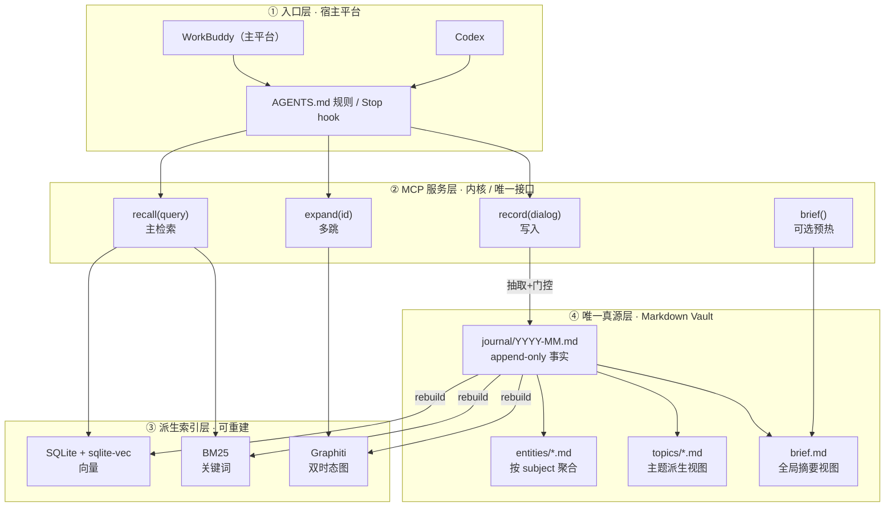
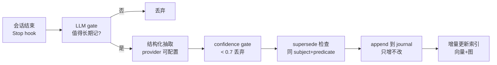

# 连溯（Liansu）— 本地长期记忆系统技术方案

> 版本 v1.0 · 2026-11-21 · 状态：方案定稿，待落地
> 一句话定位：**以 Markdown vault 为唯一真源、以 MCP 为唯一接口、全自动抽取的本地个人长期记忆系统**。

---

## 0. 一页纸摘要

| 维度 | 结论 |
|---|---|
| 产品形态 | 本地 MCP server + vault 文件，**无独立 UI**；WorkBuddy 是主平台外壳 |
| 唯一对外接口 | MCP（`record` / `recall` / `expand` / `brief`） |
| 真源 | Markdown vault（独立目录，不与 `~/ObsidianVault` 混用），append-only |
| 索引 | Graphiti 双时态图 + SQLite/sqlite-vec 向量 + BM25，全部可从真源重建 |
| 抽取 | 宿主 Stop hook 全自动触发 → LLM gate 过滤 → 结构化事实 → confidence gate → supersede |
| 检索 | 规则引导 agent 按需调 `recall`/`expand`；`brief()` 仅可选预热 |
| 模型 | provider 抽象层，默认走 Windows 主机 OpenAI-compatible /v1 服务，config 可切其他，不写死 |
| 评测 | 公开集做基线 + 自建集调参，分阶段消融 |
| 交付价值 | 空窗期可讲 10 分钟、可开源可 demo 的 Agent 项目 |

**命名**：连溯 —— 延续「连X」传统（连枢/连阅/连砺），「溯」指追溯事实的时间演变，对应双时态设计。

---

## 1. 定位与边界

### 1.1 解决什么问题

- Agent 每次会话从零开始，反复询问同样的个人信息与偏好；
- 记忆散落在各平台配置里，不可迁移、不可审计、不可重建；
- 事实有保质期，过期信息（如旧工作、旧城市）会污染回答。

### 1.2 明确不做（边界）

- 不做多租户、云端服务、独立 UI；
- 不替代 Obsidian —— Obsidian 只是可选的图谱查看器，不是必需组件；
- 不做实时协同编辑 —— 多设备靠 vault 同步 + append-only 规避冲突。

### 1.3 已排除的方案（避免重复踩坑）

| 已否方案 | 否掉的原因 |
|---|---|
| Obsidian 插件做抽取入口 | 用户日常工具链是 WorkBuddy/Codex/dsh，不用 Obsidian 开发；实测 `.obsidian/` 无 `plugins/` 目录 |
| 每 session 强制注入 brief | MCP 的 `recall` 已能被 agent 主动调用，强注入白吃 ~500 token 且有 stale 风险 |
| 用户手动触发抽取 | 用户明确要求全自动，由 hook 或规则/LLM 主导 |
| 抽取模型写死 qwen | 模型是可配置 provider，看最终部署环境决定 |

---

## 2. 主体架构

### 2.1 分层图



### 2.2 四层职责

| 层 | 职责 | 关键约束 |
|---|---|---|
| ① 入口 | 宿主平台发出写入/检索意图 | 靠 Stop hook + AGENTS.md 规则引导，不做 Obsidian 插件 |
| ② MCP 服务 | 唯一对外协议，暴露 4 个工具 | 工具描述要写清使用场景，agent 才知道何时调 |
| ③ 派生索引 | BM25 + 向量 + 双时态图，混合召回 | **全部可从真源重建**，不是第二真源 |
| ④ 真源 | append-only Markdown，冷温热三层 | 只有这里的信息是权威的，其余都是视图 |

### 2.3 核心设计约束（不可破）

1. **真源唯一**：`journal/` 是唯一权威，索引与视图崩了可全量 `rebuild`；
2. **协议收敛**：所有能力通过 MCP 暴露，不搞第二套 HTTP API；
3. **派生只读**：`entities/`、`topics/`、`brief.md` 是派生视图，禁止反向写回；
4. **时效内建**：每条 fact 带 `valid_from`/`valid_to`，能回答「现在是否成立」。

---

## 3. 核心数据模型：Fact Schema

采用「三元组骨架 + 原始 statement 证据 + 时效元数据」的混合结构（选型理由见 5.3）：

```yaml
- id: F-20261121-001
  subject: 梁明晗
  predicate: 求职目标城市
  object: 北京
  statement: "梁明晗决定求职目标城市定为北京"   # 原始自然语言，供 LLM 读
  valid_from: 2026-11-21
  valid_to: null                              # null = 当前仍成立
  confidence: 0.92
  topics: [求职, 城市]                         # 主题锚点，唯一主题真源
  source: codex://rollout-2026-11-21-xxx
  created_at: 2026-11-21T22:00:00+08:00
  supersedes: F-20261001-007                  # 覆盖旧事实（旧的是"北京/西安未定"）
```

**supersede 语义（落地修订）**：不删旧行，也**不原地改旧行的 `valid_to`**。改为追加一条 `supersede` 事件（记录 `old_id` + `new_id` + `at`），读时重放事件流计算失效状态。这是时效性与「现在是否成立」的实现基础。

> 修订理由：原地改旧行会破坏 append-only 铁律，且并发/多设备下易冲突。事件流方案让真源保持纯追加，同时时效仍可表达，每次记忆变更都能 `git diff` 审计。实现见 `src/liansu/vault/journal.py`。

---

## 4. 三条主线流程

### 4.1 记忆提取（写路径）



要点：
- **触发**：宿主 Stop hook 全自动；拿不到会话文本时降级到 hook stdin 或定时轮询兜底（见 5.1）；
- **gate**：先用便宜模型/规则判断「这轮有没有值得记的」，纯代码改动、闲聊直接跳过，省成本；
- **门控**：confidence < 0.7 丢弃；可借鉴 lorekeep 双阈值（≥0.8 入主索引，0.5–0.8 挂待确认区）；
- **落盘**：只 append，更新靠 supersede，天然规避多设备并发冲突。

### 4.2 检索（读路径）

主路径是**规则引导的按需检索**，不是每 session 强注入：

1. AGENTS.md 写规则，如「涉及用户画像/历史决策时，先调 `liansu.recall`」；
2. agent 判断需要 → 调 `recall(query)`；需要关联/多跳 → 调 `expand(fact_id)`；
3. 三路召回：BM25（人名/专名精确）+ 向量（语义）+ 图（仅 expand）；
4. 加权 RRF 融合 → 时效过滤（`valid_to < now` 降权/剔除）→ TopK 带 source 返回；
5. `brief()` 仅两种场景用：长任务开局要全局画像、用户主动 `@` 引用。

### 4.3 评测

| 阶段 | 动作 | 目的 |
|---|---|---|
| 建集 | 公开集（LongMemEval/LoCoMo/HotpotQA/FreshQA）+ 自建 vault gold facts | 公开集证明方法，自建集调真实场景 |
| 消融 | Stage0 BM25 → +向量 → +图 → +时效 → +LLM重排 | 看每层边际增益，避免无效复杂度 |
| 指标 | HitRate/Recall@K/MRR、Faithfulness、时效正确率、抽取 precision、成本/延迟 | 检索+生成+时效+成本四维 |
| 回归 | LLM-as-Judge / G-Eval 打分，反调 confidence 阈值、RRF 权重 | 形成「评测→诊断→调参→回归」闭环 |

---

## 5. 关键选型：多方案对比与推荐

> 以下 9 个点是真正可调、值得决策的地方。每点给对比表 + 推荐 + 理由。★ = 推荐方案。

### 5.1 抽取触发机制

| 方案 | 优点 | 缺点 | 适用 |
|---|---|---|---|
| ★ A. 宿主 Stop hook | 全自动、时机准、零额外 token | 依赖 hook 支持，stdin 字段需实测 | Codex/WorkBuddy 主路径 |
| B. 定时轮询会话文件 | 不依赖 hook | 有延迟；活跃会话可能未落盘（实测 `sessions/` 为空） | hook 拿不到文本时兜底 |
| C. 显式 `record` | 最可靠 | 手动，违背全自动要求 | 调试/兜底 |
| D. LLM 每轮自主判断 | 全自动 | 消耗额外 token、时机不可控 | 不推荐 |

**推荐 A，B 兜底**。实测 Codex `~/.codex/hooks.json` 已有 Stop hook（`auto_review.py`），可复用同一机制。首要风险是 `sessions/` 为空、归档在 `archived_sessions/*.jsonl.zst`——需先验证 Stop 触发时能否拿到当前对话。

### 5.2 模型 provider

| 方案 | 优点 | 缺点 | 适用 |
|---|---|---|---|
| ★ A. Windows 主机 OpenAI-compatible /v1 | 复用现有算力、无需本地拉模型、接口标准 | 依赖主机在线、需配 base_url 与模型名 | **当前默认** |
| B. 本地 Ollama | 零成本、离线可用 | 需拉模型、本机无 GPU 则慢 | 离线兜底 |
| C. 云端 API（DeepSeek/qwen-plus） | 质量高、省心 | 有成本、数据外发 | judge / 难题按需 |
| ★ D. provider 抽象层 + config 切换 | 灵活、可按需混用 | 多一层抽象 | 架构层（必选） |

**推荐 D 为架构 + A 为默认实现**：gate / 抽取 / judge 统一走 provider 层，`config.yaml` 一处切换。默认指向 Windows 主机的 OpenAI-compatible 端点；base_url、api_key、model 全部配置化，不写死。

#### 5.2.1 Windows 主机服务接入参数（2026-11-22 实测）

来源：WorkBuddy 空间文档《Windows LLM 服务接入说明》(`ybHVUO0xCIhgDNBlFMGwhp`)；本机 curl 实测四端点均通。

| 项 | 值 | 备注 |
|---|---|---|
| 主机 | `192.168.0.101` | **IP 会变**（曾 `.103`→`.100`→`.101`，2026-11-23 实测）。已自动化：从 Deskflow 已建立连接反查对端 IP（`lsof -nP -iTCP:24800 -sTCP:ESTABLISHED`），每次调用实时读取；`curl /health` 由 resolver 内置 |
| 推理服务 | llama.cpp `llama-server`，端口 **8080** | OpenAI Chat Completions 协议 |
| base_url | `http://192.168.0.100:8080/v1` | 带 `/v1`，SDK 会拼 `/chat/completions` |
| api_key | `dummy` | 本地服务不校验，随意填 |
| model | `local` | 服务端只有一个模型 Qwen3-14B-Q4_K_M，忽略 model 字段匹配；惯例填 `local` |
| 模型/硬件 | Qwen3-14B-Q4_K_M（≈9GB）/ RTX 4070 SUPER 12GB / ngl 99 / ctx 8192 | 抽取够用 |
| 结构化输出 | 原生支持 `response_format: json_schema` | 实测可用，记忆抽取走此方式 |
| **必加参数** | `"chat_template_kwargs": {"enable_thinking": false}` | Qwen3 默认开 thinking，不关会在 JSON 外混入思考文本 |
| 端点状态 | `/v1/chat/completions` 200、`/v1/models` 200、`/health` 200；**`/api/chat`、`/api/generate` 404** | **不是 Ollama 协议**，不能把 Ollama client 的 base_url 直接指过来 |
| 实测延迟 | prompt 543ms / 2 token 24ms（短回复） | 本地局域网上限主要受 14B 推理速度约束 |

**DHCP 自适应（已实现）**：`config.yaml` 的 `base_url` 用模板 `http://{deskflow_host}:8080/v1`。实际拓扑是 **macOS 跑 Deskflow server、Windows 跑 client**，所以 `src/liansu/deskflow.py` 优先用 `lsof -nP -iTCP:24800 -sTCP:ESTABLISHED` 读取已连接客户端的远端 IP——Windows 服务/Deskflow 每次启动重连后，这个 IP 就是 DHCP 最新地址，liansu 每次调用接口都会实时读取，不依赖静态配置。实时连接不可用时才退回 Deskflow 配置 `[client] remoteHost`（本机作为 client 的拓扑）与 `fallback_host`。候选地址剥离 `/v1` 后逐个探测 `/health`；`ApiProvider` 在连接失败时强制重读并重建 OpenAI client。运维检查：`.venv/bin/liansu endpoint --refresh`（输出 `source=live` 即命中实时连接）。

**业务层 8001（memory-server）**：`POST /extract` 接收 `{text, speaker}`，返回 `{memories:[{type, content, importance}]}`，内部调 8080；另有 `/health`、`/metrics`。

> **架构决策**：8001 的抽取结果与连溯 Fact schema 不兼容——它只有 `content/importance`，缺 `subject/predicate/object/valid_from/supersedes/topics`，无法支撑去重、双时态和多跳。因此连溯**不直接复用 8001 的 `/extract`**，而是走 8080 的标准 Chat + JSON Schema，按自己的 schema 抽取（T2/T4）。8001 仅作为可选对照基线保留，不作为数据入口。

**可观测**（可选，不进 MVP）：`http://192.168.0.100:3000` Grafana（admin/admin，5s 刷新，QPS/延迟/Token 吞吐）、`:9090` Prometheus（15s 抓取）、8080 `/metrics` 原生指标前缀 `llamacpp:`、8001 业务指标前缀 `memory_`。运维日志在 Windows `C:\llama\llama-server.log` 等，四个服务开机自启。

### 5.3 Fact schema 形态

| 方案 | 优点 | 缺点 | 适用 |
|---|---|---|---|
| A. 三元组 (s,p,o) | 结构化强、利于图与去重 | 表达受限、复杂事实难塞 | 图索引 |
| B. statement + 元数据 | LLM 易生成、表达自由 | 结构化弱、难做实体聚合 | 抽取中间态 |
| C. episode 片段 | 可追溯原始对话 | 冗余大 | 审计 |
| ★ D. A 骨架 + B 的 statement 作 evidence | 兼顾结构化与可读性 | schema 稍复杂 | 最终落盘 |

**推荐 D**：三元组做骨架（去重、建图、时效），statement 字段保留原文供 LLM 理解与审计。

### 5.4 真源粒度

| 方案 | 优点 | 缺点 | 适用 |
|---|---|---|---|
| A. 单 fact 单文件 | 粒度细、git diff 清晰 | 文件爆炸（数千个） | 小规模 |
| B. 按 subject 聚合文件 | Obsidian 友好、可读 | append 要改文件，并发冲突 | 派生视图 |
| ★ C. 纯 journal 时间分片 append-only | 并发安全、实现简单 | 按实体看要检索 | 真源 |

**推荐 C 为真源 + B 为派生视图**：`journal/YYYY-MM.md` append-only 是权威；`entities/` 按 subject 聚合是 rebuild 出来的视图。这与冷温热分层一致，避免多真源。

### 5.5 向量存储

| 方案 | 优点 | 缺点 | 适用 |
|---|---|---|---|
| ★ A. SQLite + sqlite-vec | 单文件、零服务、随 vault 同步、Python 原生 | 百万级性能一般 | 个人规模（万级 fact） |
| B. Chroma | API 友好、元数据过滤强 | 多一个服务/目录、依赖重 | 中等规模 |
| C. FAISS | 性能最强、成熟 | 无元数据管理、持久化自己写 | 大规模 |
| D. LanceDB | 列式、版本化、多模态 | 较新、生态小 | 前瞻 |

**推荐 A**：个人记忆规模万级足够，零运维最符合「本地 + 可重建」定位。万级到不了 sqlite-vec 的性能天花板。

### 5.6 时序图方案

| 方案 | 优点 | 缺点 | 适用 |
|---|---|---|---|
| ★ A. Graphiti | 双时态原生、增量更新、MCP 生态亲和 | 依赖 LLM 抽实体边（成本）、较新 | 终态 |
| B. networkx 自建 + YAML 边 | 完全可控、零依赖 | 双时态/实体消歧自己实现，工作量大 | 不想引外部依赖时 |
| C. 不上图（BM25+向量+时效） | 最简单 | 无多跳/实体聚合 | W1-2 基线 |

**推荐 A，但分阶段**：W1-2 先用 C 跑通基线（呼应「先 embedding 建边，别上来全量 LLM」的教训），W7-8 再引入 Graphiti。这样能量化图到底带来多少增益。

> **落地修订（2026-11-22）**：Graphiti 依赖 neo4j，本地无该服务。实际采用**方案 B（networkx 自建双时态图）**，接口严格遵循 `Index` ABC（`add/search/rebuild/close` + `neighbors`），后续若要换 Graphiti 只需替换 `index/graph.py` 实现，上层 fuse/expand/mcp 零改动。这正好验证了「接口先行、实现可换」的设计。

### 5.7 召回融合策略

| 方案 | 优点 | 缺点 | 适用 |
|---|---|---|---|
| ★ A. 加权 RRF | 实现简单、无需训练、尺度无关 | 权重靠手调 | 主策略 |
| B. 归一化加权求和 | 直观 | 各路分数尺度不一，难归一 | 不推荐 |
| C. Cross-Encoder 重排 | 精度最高 | 延迟/算力成本 | Stage4 可选 |

**推荐 A 为主 + C 作最后一层**：与连阅经验一致（加权 RRF + BGE Cross-Encoder）。先 RRF 保证召回，最后按需上重排，并用评测验证 C 的增益是否值成本。

### 5.8 检索接口设计

| 方案 | 优点 | 缺点 | 适用 |
|---|---|---|---|
| ★ A. 三工具 recall/expand/brief | 职责清晰、agent 易选 | 工具描述要写清 | 推荐 |
| B. 单一 search(q, mode) | 接口少 | 参数复杂、agent 易混 | 不推荐 |
| C. MCP resources + 工具混合 | 合 MCP 规范 | 客户端支持不一 | 后续 |

**推荐 A**：三个工具语义分明，工具描述里写明「何时用哪个」，让 agent 自觉按需调用。

### 5.9 评测策略

| 方案 | 优点 | 缺点 | 适用 |
|---|---|---|---|
| A. 仅公开集 | 可横向对比、省事 | 英文、非个人场景 | 基线 |
| B. 仅自建集 | 贴场景 | 要人工标注、规模小 | 调参 |
| ★ C. 公开集 + 自建集 | 既证方法又调场景 | 工作量最大 | 推荐 |

**推荐 C**：公开集证明方法有效（面试可讲），自建集调真实 vault（工程够用）。

### 5.10 最优方案汇总

| 决策点 | 最优选择 | 一句话理由 |
|---|---|---|
| 抽取触发 | Stop hook 主 + 轮询兜底 | 全自动且时机准 |
| 模型 | provider 抽象，Windows 兼容端点默认 | 复用现有服务、模型可换 |
| Fact schema | 三元组 + statement 证据 | 结构化与可读性兼得 |
| 真源粒度 | journal append-only | 并发安全、单真源 |
| 向量存储 | SQLite + sqlite-vec | 零运维、规模够用 |
| 时序图 | Graphiti（分阶段引入） | 双时态原生 |
| 融合策略 | RRF + 可选重排 | 简单可靠、增益可测 |
| 检索接口 | recall/expand/brief | 语义清晰 |
| 评测 | 公开集 + 自建集 | 证明 + 调参兼备 |

---

## 6. 技术栈清单

| 层 | 技术 |
|---|---|
| 服务框架 | Python + FastMCP（stdio 起步，进阶 Streamable HTTP） |
| 真源 | Markdown + YAML frontmatter，独立 vault 目录 |
| 抽取 | provider 抽象层；默认 Windows llama-server OpenAI-compatible /v1（`openai` SDK）+ `response_format: json_schema` + 关 thinking |
| 向量 | bge-small-zh + sqlite-vec |
| 关键词 | rank_bm25 |
| 图 | Graphiti（双时态），W1-2 用 networkx/纯向量基线 |
| 常驻 | launchd (macOS) / systemd (Linux) |
| 压缩归档 | zstd（Codex 归档会话是 `.jsonl.zst`） |
| 评测 | LongMemEval / LoCoMo / HotpotQA / FreshQA + 自建集 |

---

## 7. 环境现状与前置任务

实测（2026-11-21，LLM 部分 11-22 更新）：

| 项 | 现状 | 动作 |
|---|---|---|
| **LLM 服务** | **Windows `192.168.0.100:8080` llama-server 已实测连通**，`model:"local"` 调用成功 | 按 §5.2.1 填 config；接入前 `curl /health` 确认 IP 未变 |
| Ollama CLI | 在 `/opt/homebrew/bin/ollama`，但无模型、python 包未装 | **不再必需**；仅作离线兜底时才装 |
| Codex hook | 已有 Stop hook（`auto_review.py`）+ `notify = turn-ended` | 复用机制，挂 `liansu` |
| Codex 会话 | `sessions/` 空；归档 `archived_sessions/*.jsonl.zst` | **实测 Stop 触发时能否拿到对话**（最高优先级） |
| WorkBuddy MCP | `mcp.json` 已配 lighthouse-ops（streamableHttp）；工具缓存有 `library_search` | 确认能加本地 server |
| Python 依赖 | fastmcp/rank-bm25/sqlite-vec/sentence-transformers 全未装 | pip 安装；LLM 侧另需 `openai` SDK |

**执行前必清三件事**：① 验证 hook 拿对话文本；② 装 Python 依赖（模型不用拉，走 Windows 服务）+ 填 LLM config；③ 抽 20 条 fact 手搓最小评测集跑通 Stage0。

---

## 8. 实施路线（约 10 周）

| 阶段 | 交付 | 验证点 |
|---|---|---|
| W1-2 | MVP：vault + MCP `record`/`recall` + 手动 record + BM25 基线 | 写入-检索跑通，Stage0 有数 |
| W3-4 | 抽取全自动：hook + LLM gate + confidence + supersede | 会话结束自动落盘，无需手动 |
| W5-6 | 检索增强：向量 + RRF + 时效过滤；规则引导按需检索 | Stage1/2 增益可测 |
| W7-8 | Graphiti 双时态图 + `expand` + 冷温热视图 rebuild | 多跳与时效问答可用，Stage3 有数 |
| W9-10 | 开源整理：README + demo + 评测报告 + 面试讲稿 | 能讲满 10 分钟 |

---

## 9. 风险与缓解

| 风险 | 影响 | 缓解 |
|---|---|---|
| Stop hook 拿不到会话文本 | 写路径无法全自动 | 先实测；降级用 hook stdin / 定时轮询 / 手动 record 兜底 |
| 会话边界不准 | 截断或漏提 | 全自动 hook + 短空闲兜底 + 手动 record 可补 |
| LLM 抽取烧钱 | 成本失控 | gate 前置过滤 + 本地模型 + 冷启动 embedding 基线 |
| 过期事实污染 | 回答错误 | valid_to + 时效过滤 + supersede 覆盖 |
| 索引与真源不一致 | 检索错乱 | 索引全派生、可 rebuild，禁止反向写回 |
| 多设备并发 | 文件冲突 | journal append-only，视图 rebuild |

---

## 附录 A：MCP 接口草案

```text
record(dialog: str, source: str) -> list[Fact]
    # 全自动抽取入口；hook 拿到对话后调用
    # 内部：LLM gate → 结构化抽取 → confidence → supersede → append

recall(query: str, top_k: int = 5) -> list[ScoredFact]
    # 主检索；BM25 + 向量混合，RRF 融合 + 时效过滤
    # 返回 fact_id / statement / confidence / valid_from / source

expand(fact_id: str, hops: int = 1) -> list[Fact]
    # 基于 Graphiti 图的多跳关联，仅在需要关联推理时调用

brief(max_tokens: int = 500) -> str
    # 可选：生成全局摘要，用于长任务开局或用户显式 @ 引用

rebuild() -> status
    # 从 journal 全量重建所有索引与视图（向量、图、entities、topics、brief）
```

## 附录 B：关键取舍口诀

- **真源唯一，索引可重建** —— 架构第一原则；
- **hook 全自，brief 可选** —— 写入全自动，读取按需查；
- **便宜门控，贵在刀刃** —— gate 用便宜模型，judge 才考虑 API；
- **事实保鲜，只增不改** —— 时效靠 valid_to，并发靠 append-only。

---

## 10. 落地状态（2026-11-22）

17 个任务 / 5 个波次全部完成，129 个测试通过。与方案的两处偏差已在正文标注修订：

| 项 | 方案原述 | 落地实现 | 原因 |
|---|---|---|---|
| supersede | 原地改旧行 `valid_to` | 追加 `supersede` 事件流，重放计算 | 保住 append-only |
| 双时态图 | Graphiti | networkx 自建（同 `Index` 契约） | neo4j 不可用，接口可换 |
| 向量库 | sqlite-vec | sqlite-vec + 纯 Python cosine 兜底 | 扩展不可用时仍能跑 |

已验证链路：`record → gate → extract → confidence → supersede → append → 索引增量`（写）与 `recall（BM25+向量 RRF → 时效过滤）→ expand（多跳）`（读）。宿主接线见 `docs/integration.md`，hook 实测结论见 `docs/hook-probe.md`。
